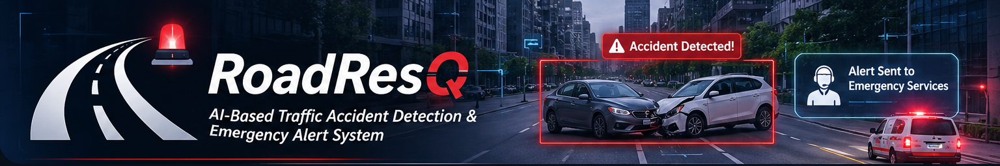

  

  <h1>RoadResQ</h1>
  <h3>AI-Based Traffic Accident Detection & Emergency Alert System</h3>
  
<b>Smarter Detection. Faster Response. Safer Roads.</b>

---Overview
RoadResQ is an AI-based traffic accident detection and emergency alert system designed to support road safety and improve the flow of incident information to emergency response teams.

The project explores how computer vision and artificial intelligence can be used to analyze traffic scenes, identify potential accident events, extract relevant incident details, and deliver structured alerts through a backend service.

The current development and evaluation workflow uses simulated traffic scenarios in the CARLA simulator.
Problem Statement
Traffic incidents need to be identified and communicated quickly. When an incident is detected late or important details are unavailable, emergency response coordination may become more difficult.

RoadResQ aims to develop an automated pipeline that analyzes traffic scenes, detects potential accidents, and provides structured incident information to support faster and more informed response.
Project Objectives
- Develop an AI-based approach for traffic accident detection.
- Create and evaluate traffic scenarios in CARLA.
- Analyze visual data from simulated traffic scenes.
- Extract relevant information about detected incidents.
- Connect the detection pipeline to a backend API.
- Present structured accident alerts for monitoring and response.
System Workflow
CARLA Traffic Simulation
          |
          v
     Data Capture
          |
          v
   Visual / AI Analysis
          |
          v
   Accident Detection
          |
          v
 Incident Information
          |
          v
     Flask Backend
          |
          v
   Emergency Alert
Core Components
Component	Description
Traffic Simulation	Creates traffic scenarios using CARLA
Data Capture	Collects visual data from simulated scenes
AI Detection	Analyzes traffic imagery for vehicles and potential accident events
Incident Analysis	Organizes relevant information about a detected event
Backend API	Receives and serves incident data
Alert Interface	Presents incident information for monitoring

Technologies & Tools
Technology	Role
Python	Core development language
CARLA Simulator	Traffic simulation and scenario generation
Computer Vision	Visual traffic-scene analysis
Flask	Backend API
REST API	Communication between system components
Git & GitHub	Version control and team collaboration

The technology list will be updated as implementation evolves.
Repository Structure
The structure below is a proposed organization and may change during development.
RoadResQ/
├── simulation/       # CARLA scenarios and simulation scripts
├── data/             # Collected or prepared datasets
├── detection/        # AI and computer-vision modules
├── backend/          # Flask API
├── frontend/         # Monitoring interface (if applicable)
├── docs/             # Documentation and diagrams
└── README.md
Development Status
RoadResQ is currently under development.

The team is building the simulation and backend foundations and developing the AI detection and integration workflow. Features and evaluation results will be documented here as they are implemented and validated.
Evaluation Plan
The system will be evaluated using measurable criteria such as:
- Accident detection performance.
- Detection precision and recall.
- False positive and false negative rates.
- Alert delivery latency.
- Performance across different traffic scenarios.
Metrics will be added after experiments have been conducted.
Team
Developed by the RoadResQ Team.

Team members and individual contributions will be added as the repository is organized.
Future Work
- Expand the range of traffic scenarios.
- Improve and validate accident detection.
- Integrate AI outputs with the backend API.
- Develop an incident-monitoring interface.
- Measure system performance and alert latency.
- Investigate applicability to real-world traffic monitoring workflows.

RoadResQ — Smarter Detection. Faster Response. Safer Roads.

